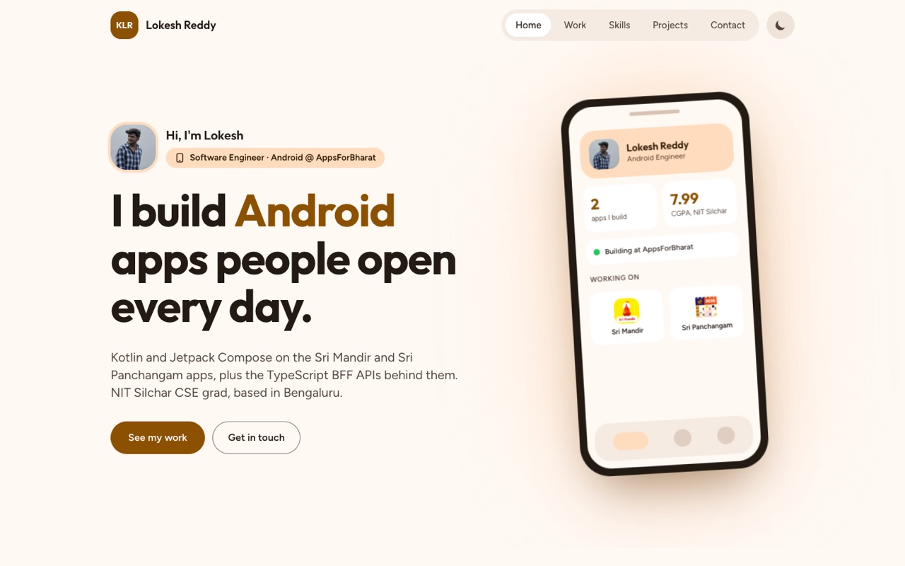

<h1 align="center">
  
</h1>

<p align="center">
  <a href="https://react.dev/" target="_blank"></a>
  <a href="https://tailwindcss.com/" target="_blank"></a>
  <a href="https://vitejs.dev/" target="_blank"></a>
  <a href="https://developer.mozilla.org/docs/Web/JavaScript" target="_blank"></a>
  <a href="https://lokesh-reddy18.netlify.app/" target="_blank"></a>
  <a href="https://github.com/Lokesh-reddy18" target="_blank"></a>
  <a href="https://www.linkedin.com/in/kolli-lokesh-reddy/" target="_blank"></a>
  <a href="mailto:kollilokeshreddy18@gmail.com"></a>
</p>
<!-- Animated Divider with theme color shimmer effect -->
<p align="center">
  
</p>

<p align="center">
  <a href="https://lokesh-reddy18.netlify.app/">
    <picture>
      <source media="(prefers-color-scheme: dark)" srcset="docs/screenshot-dark.jpg">
      
    </picture>
  </a>
</p>

## 🚀 About This Project

> **A modern, blazing-fast, and fully responsive portfolio built with [React](https://react.dev/) & [Tailwind CSS](https://tailwindcss.com/) using [Vite](https://vitejs.dev/).**

✨ This portfolio website showcases my work as a Software Engineer (Android) at AppsForBharat, along with my projects, skills, education, and offers a seamless way to connect with me.<br>
Feel free to explore and get inspired!


## ✨ Features

- 🤖 **Android-native design** in a Material 3 style, with a saffron tonal palette in light and dark mode
- 🎞️ **Thoughtful motion**: word-by-word hero, phone mockup that cycles screens and tilts toward the cursor, sliding nav, scroll reveals, press ripples and a circular theme switch. All of it switches off for `prefers-reduced-motion`
- 📱 **Fully responsive**, keyboard-accessible, and scores 100 across Lighthouse on mobile and desktop
- 🛍️ **Play Store cards** for the Sri Mandir and Sri Panchangam apps I work on
- 📬 **Contact form** that emails messages via [Web3Forms](https://web3forms.com), plus one-tap copy of my email
- 📄 **Resume button** that appears automatically once `public/resume.pdf` is added

> To update content, edit the files in `src/data/` — no component changes needed.


## 📁 Project Structure

```bash
Portfolio/
├── docs/               # README screenshots
├── public/
│   ├── icons/          # Self-hosted skill, social and app icons
│   ├── projects/       # Profile photo and project screenshots
│   └── 404.html        # Branded not-found page (standalone, no React)
├── src/
│   ├── components/     # One component per section, plus Reveal and Ripple helpers
│   ├── data/           # Profile, experience, projects and skills content
│   ├── hooks/          # useDarkMode, useActiveSection, useInView, useCountUp
│   ├── index.css       # Material 3 colour tokens and animation styles
│   ├── App.jsx
│   └── main.jsx
├── index.html          # Meta tags, JSON-LD and the no-flash theme script
├── netlify.toml        # Security headers and asset caching
├── tailwind.config.js  # Maps Tailwind colours to the Material tokens
└── vite.config.js      # Detects whether a resume PDF is present
```

## 🛠️ Getting Started

Ready to run this portfolio locally? Just follow these steps:

1. **Clone this repository**
    ```bash
    git clone https://github.com/Lokesh-reddy18/Portfolio.git
    cd Portfolio
    ```

2. **Install dependencies**
    ```bash
    npm install
    ```

3. **Start the development server**
    ```bash
    npm run dev
    ```

4. **Open your browser** and visit [`localhost:5173`](http://localhost:5173) (or the output URL).


## 🌐 Live Demo

<p align="center">
  <a href="https://lokesh-reddy18.netlify.app/" target="_blank">
    
  </a>
</p>


## 🤝 Connect with Me

<p align="center">
  <a href="https://www.linkedin.com/in/kolli-lokesh-reddy/" target="_blank">
    
  </a>
  <a href="mailto:kollilokeshreddy18@gmail.com">
    
  </a>
  <a href="https://github.com/Lokesh-reddy18" target="_blank">
    
  </a>
</p>

<!-- Animated Footer with theme color wave and shimmer -->
<p align="center">
  
  <br/>
  <b>Made with ❤️ by <a href="https://github.com/Lokesh-reddy18">Kolli Lokesh Reddy</a></b>
</p>
